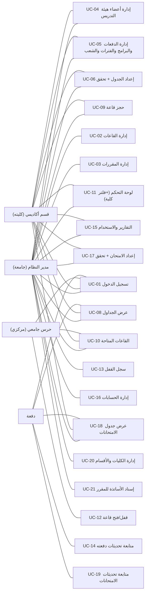

# 02 — حالات الاستخدام (Use Cases) — تسليم (معتمد: الامتحانات داخل النطاق + دبلوم/بكلاريوس)

> محسوب وفق الأدوار الأربعة المعتمدة (مدير النظام / قسم أكاديمي / حرس جامعي / دفعة) بلا أسوار أقسام، والشاشات الـ8 + وحدة الامتحانات الجديدة، والنطاق **يشمل الامتحانات الآن**.
> الجدولة على مستوى **الشعبة** (الدفعة × المسار: دبلوم/بكلاريوس)، والدفعة تبقى الحاوية الإدارية للعرض والإشعارات.

## 2.1 الأدوار

| الدور | الرمز | يرى |
|---|---|---|
| مدير النظام (جامعة) | `admin` | كل الجامعة: كليات/أقسام/قاعات/مقررات/دفعات + فلتر كلية اختياري في اللوحة |
| قسم أكاديمي (فريق كلية) | `dept` | **كليته فقط**: دفعاتها وشعبها أعضاء كليته + جداولها وحجوزاتها وامتحاناتها؛ **المقررات للقراءة فقط** (يعدلها admin فقط) |
| حرس جامعي (مركزي) | `guard` | كل قاعات الجامعة + سجل القفل كامل — لا تعديل جداول مهما كانت |
| دفعة | `batch` | فقط: جدول وامتحانات دفعتها (دبلوم + بكلاريوس) + تحديثاتهما — لا يرى دفعات أخرى |

## 2.2 مخطط حالات الاستخدام (Mermaid)

ملاحظات: UC-08 للأدوار الـ3 (admin/dept/batch بخلاف batch محصور بدفعته). كل تحقق تعارض يرجع أسبابًا مرقّمة بالعربية (قاعة / مدرس / دفعة / سعة / تجهيزات / حالة / قفل). **علامة `*` بعد dept = ضمن نطاق كليته فقط (faculty-scoping عبر `users.faculty_id`)**.

## 2.3 جدول حالات الاستخدام

| # | الاسم | الفاعل | الشرط المسبق | المسار الرئيسي (بإيجاز) | ما بعد الشرط |
|---|---|---|---|---|---|
| UC-01 | تسجيل الدخول | الكل | حساب نشط + دور | يدخل ID/كلمة المرور → النظام يتحقق (Hash) ويحدد الدور → يحوّل حسب الدور | `users.last_login_at` يتحدث → تحديثات «جديد» للدفعة تُنبه عند العرض |
| UC-02 | إدارة القاعات | admin | — | عرض/بحث/إضافة/تعديل/حذف (soft delete) قاعة: الاسم(فريد)، السعة>0، الحالة∈(متاحة/صيانة/مغلقة)، النوع∈(قاعة/معمل)، التجهيزات | D1 محدث؛ لا حذف لقاعة لها جداول/حجوزات نشطة |
| UC-03 | إدارة المقررات | admin | — | رمز(فريد)/اسم/ساعات/تجهيزات مطلوبة + **قائمة الأساتذة المكلفين بالتدريس (وعاء course_faculty) — من نفس الشاشة** — **جامعية مشتركة**، لا يعدّلها dept | D2 + D14 (إسناد الأساتذة) محدثة |
| UC-04 | إدارة أعضاء هيئة التدريس | admin, dept* | — | الاسم/القسم(التابع له)/البريد(فريد)/الهاتف — dept يدخل ويعين أعضاء كليته فقط | D3 محدث |
| UC-05 | إدارة الدفعات والبرامج والفترات والشعب | admin, dept* | — | برنامج (صباحي/مسائي) له فتراته؛ دفعة تنتمي لقسم في كلية؛ شعبة (دبلوم/بكلاريوس) لكل دفعة؛ عدد الطلاب>0 لكل شعبة — dept يدير دفعات كليته فقط | الكيانات: programs/periods/faculties/departments/batches/groups محدثة؛ تُستخدم في عرض/إعداد الجداول والامتحانات |
| UC-06 | إعداد الجدول + تحقق تعارض | admin, dept | البيانات الأساسية موجودة | يختار مقرر/عضو(**من وعاء course_faculty للمقرر**)/دفعة/قاعة/يوم/من←إلى → «تحقق من التعارض» (يضم شرط الأهلية R13) → تقرير (×n سبب) → «حفظ في الجدول» | الكتابة في D5 + صف في D9 للشعبة |
| UC-07 | حفظ في الجدول | admin, dept | تحقق سابق بلا أسباب hard | transaction: FOR UPDATE على القاعة → إعادة الفحص (Go) → إدراج D5 + D9 | جدول محدث، سجل updateType=add |
| UC-08 | عرض الجداول | admin, dept, batch* | — | يختار «دفعة/عضو هيئة تدريس/قاعة» + «حسب» → يعرض الشبكة الأسبوعية حسب **فترات برنامج الدفعة** | واجهة فقط |
| UC-09 | حجز قاعة | admin, dept | قاعة + تاريخ + وقت + مقرر أو نشاط | يختار قاعة/تاريخ/من←إلى/مقرر-أو-نشاط → حالة القاعة في الوقت المحدد تضاء «متاحة» → «تأكيد الحجز» | D6 صف جديد (confirmed)؛ تحقق مطابق لـ P2 داخل transaction |
| UC-10 | القاعات المتاحة | admin, dept, guard | — | يدخل التاريخ/من←إلى/أقل سعة → يطغى بطاقات القاعات المطابقة → زر «احجز» (admin/dept فقط) | — |
| UC-11 | لوحة التحكم | admin, dept* | — | KPIs (قاعات مسجلة/محاضرات الفصل/حجوزات اليوم/قاعات متاحة الآن) + آخر الحجوزات + تنبيهات تعارض — admin: الجامعة (+فلتر كلية اختياري)؛ dept: كليته فقط | استعلام مجمّع (عبر Go إن تقرر) |
| UC-12 | قفل/فتح قاعة (guard مركزي) | guard | — | «القاعات الخالية الآن» (محاضرة/حجز/امتحان حالي) → قفل مع ملاحظات أو فتح | D8 سجل القفل؛ مرفوض إن وُجدت محاضرة/امتحان/حجز **حالي** في القاعة |
| UC-13 | سجل القفل | admin | — | جدول زمن/حارس/قاعة/الإجراء/ملاحظات | — |
| UC-14 | متابعة تحديثات دفعته | batch | — | قائمة D9 لدفعته منذ `last_login_at` مع نوع (إضافة/تعديل/إلغاء) ووصف | — |
| UC-15 | التقارير والاستخدام | admin, dept* | — | يختار نوع التقرير/الفترة → نسبة استخدام القاعات (مخطط+جدول: عدد المحاضرات/النسبة) → «تصدير» CSV — admin: الجامعة أو فلتر كلية؛ dept: كليته فقط | — |
| UC-16 | إدارة الحسابات | admin | — | CRUD users: username(فريد)/كلمة مرور(مشفرة bcrypt)/الاسم/الدور؛ ربط حساب دفعة بدفعته | — |
| UC-17 | إعداد الامتحان + تحقق تعارض | admin, dept | المقررات والشعب متوفرة، والامتحان ≥ 2 ساعات اختياري | يختار المقرر/الشعبة/القاعة/التاريخ/من←إلى/النوع (اختبار قصير/ميدترم/فاينل) → «تحقق من التعارض» (القاعة عبر امتحانات ومحاضرات ونفس التاريخ/الفترة + حد أقصى امتحانين للشعبة في اليوم) → بلا hard ← **«حفظ في جدول الامتحانات»** | `EXAM_SESSIONS` صف جديد + صف في `EXAM_UPDATES` (إضافة) للشعبة |
| UC-18 | عرض جدول الامتحانات | admin, dept, batch* | — | تعرض حسب «الشعبة» أو المقرر؛ يعرض الشبكة حسب **أيام وتاريخ الامتحانات** (لا شبكة فترات متكررة)؛ تصدير CSV | — |
| UC-19 | متابعة تحديثات الامتحانات | batch | — | قائمة `EXAM_UPDATES` لشعبَتي دفعته منذ `last_login_at` مع النوع (إضافة/تعديل/إلغاء) والوصف | — |
| UC-20 | إدارة الكليات والأقسام | admin | — | CRUD كليات (اسم/رمز فريد)، CRUD أقسام (تتبع كلية واحدة) — يُستخدم عند إنشاء الدفعات وتعيين الأعضاء | D13 faculties/departments محدثة |
| UC-21 | إسناد الأساتذة للمقرر (وعاء course_faculty) | admin | مقرر موجود | من شاشة المقرر، يجدد قائمة الأساتذة المكلفين بالتدريس؛ **فريد (course_id, faculty_id)**؛ **حذف مدرّس ممنوع** ما دام له سطور سارية في `timetables` لنفس المقرر لهذا المدرّس (HTTP 422: «لا يمكن الإزالة — عدّل المحاضرات لمدرّس آخر أولًا») — تعديل/إعادة الإسناد متاح دائمًا | D14 محدثة؛ R13 تُفرض وقت الحفظ ووقت الحذف |

`*` batch: نفس UC-08 لكن العرض محصور بدفعته (policy)، ولا تظهر قائمة «حسب» للمدرس/القاعة.

## 2.4 قواعد عمل مشتركة (مرجع كل UC)

- **R1 ذرّية الحجز/الحفظ**: أي كتابة US-06..07 وUC-09 تتم داخل transaction مع `SELECT … FOR UPDATE` على سطر القاعة، ويعاد استدعاء Go داخل المعاملة (ضد TOCTOU).
- **R2 idempotency**: POST للحفظ/الحجز يقبل `Idempotency-Key` (UUID) ويخزّنها؛ إعادة الإرسال لا تنشئ سجلين.
- **R3 التحديثات**: أي write/edit/cancel في D5 يولّد سطرًا في D9 للدفعة المعنية بوصف موجز («تغيير الوقت/القاعة» مثلًا).
- **R4 لا تدمير**: حذف القاعات/المقررات soft delete فقط (الجداول التاريخية لا تتأثر)؛ السجلات (D8/D9) لا تُحذف بل تُلغى بحالتها.
- **R5 كلمة المرور**: تخزينها مشفّرة (Hash)؛ لا سياسة تعقيد قسري في v1 لكن حد أدنى 8 أحرف؛ تقييد محاولات الدخول (rate limit) على UC-01.
- **R6 إشعارات دفعة**: لا push؛ تُعرض «جديد» عند دخول الدفعة مقابل `users.last_login_at` فقط (محاضرات و/أو امتحانات، حسب الوسم في الكارت).
- **R7 تعارض متقاطع**: لا تستضيف القاعة نفس التاريخ/الفترة محاضرة وامتحانًا (مهما كانت الشعبة) — كلا الجدوليْن ممنوعان.
- **R8 راحة الامتحان**: حد أقصى امتحانيْن للشعبة في نفس اليوم الواحد — يُمنع الثالث في مرحلة الإدخال.
- **R9 متى يرى الـ batch؟**: كل ما يخص الدفعتين الواردتين في دفعته (دبلوم + بكلاريوس) — لا مسار خارجي، لا تعديل.
- **R10 مقررات جامعية**: لا يعدّلها إلا admin — dept يقرأ ويستخدم فقط.
- **R11 قاعات جامعية**: admin يديرها، guard مركزي يقفل/يفتح كلها، dept يحجز ويسكّن فيها.
- **R12 faculty-scoping**: كل استعلام dept يُقيَّد بـ `faculty_id` للمستخدم (عبر join `batches→departments`) في: الدفعات/الشعب/الأعضاء/الجداول/الامتحانات/الإشعارات/اللوحة والتقارير — لا تسريب بين الكليات.
- **R13 الأهلية للتدريس**: `timetables.faculty_id` **لازم** يكون موجودًا في وعاء `course_faculty` لهذا المقرر وقت الحفظ — وإلا رفض HTTP 422 «المدرّس غير مُسند لهذا المقرر». **وحذف مدرّس من وعاء مادة له عليها سطر سارٍ في `timetables` ممنوع أيضًا (نفس HTTP 422، رسالة «عدّل المحاضرات لمدرّس آخر أولًا»)** — بنية الجدول متسقة دائمًا.
