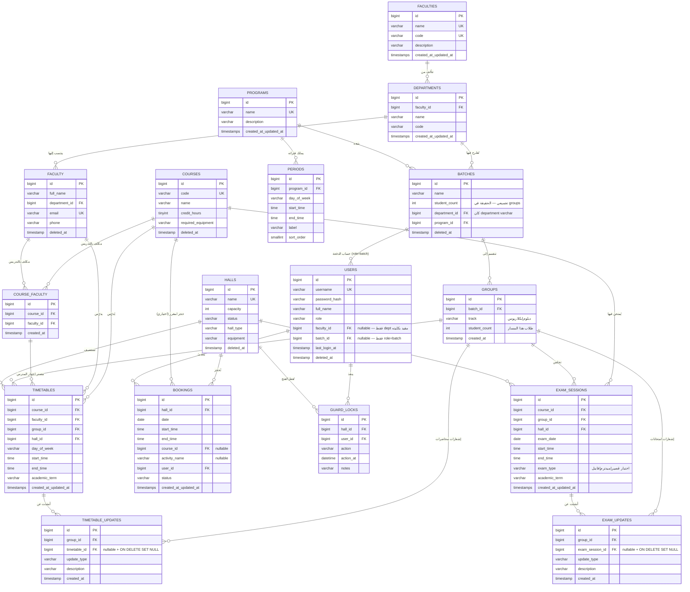

# 03 — مخطط ERD — تسليم (بعد اعتماد: الامتحانات + GROUPS + الهرم جامعة/كلية/قسم/دفعة/شعبة)

> **النموذجان السابقان أُلغيا**: لا `batches` ككيان جدولة وحيد، ولا «جامعة مسطحة»؛ الحال الآن: **جامعة ← كلية ← قسم ← دفعة ← شعبة (GROUPS)**.
> الكيانات الآن: 3 طبقات جديدة للهيكل (faculties/departments ككيانات، وbatches صارت تابعة لقسم) وسلسلة الامتحانات (exam_sessions/exam_updates).
> التسميات الإنجليزية في المخطط؛ الوصف العربي في قسم «قاموس البيانات» أدناه.

## 3.1 مخطط الكينونات والعلاقات (Mermaid)

> لا توجد أي علاقة بين PROGRAMS وFACULTIES أو بين COURSES/HALLS والكليات: **المقررات والقاعات جامعية مشتركة بلا كلية** (لا `courses.faculty_id` ولا `halls.faculty_id`) — مقصود ومقرر.

## 3.2 علاقات مفروضة (Cardinality & Constraints)

| العلاقة | النوع | قيد/ملاحظة |
|---|---|---|
| FACULTIES → DEPARTMENTS | 1 : N | `UNIQUE(faculty_id, name)`؛ RESTRICT عند حذف كلية فيها أقسام |
| DEPARTMENTS → BATCHES | 1 : N | `batches.department_id` NOT NULL؛ RESTRICT عند حذف قسم تتبناه دفعات |
| DEPARTMENTS → FACULTY | 1 : N | عضو هيئة التدريس يتبع قسمًا واحدًا (NOT NULL) |
| PROGRAMS → PERIODS | 1 : N | CASCADE على الفترات؛ يُمنع حذف برنامج تتبناه دفعات (RESTRICT) |
| PROGRAMS → BATCHES | 1 : N | `batches.program_id` NOT NULL |
| BATCHES → GROUPS | 1 : N | `UNIQUE(batch_id, track)` |
| GROUPS → TIMETABLES | 1 : N | RESTRICT على الحذف الحقيقي |
| GROUPS ↔ EXAM_SESSIONS | 1 : N | الامتحان يخص شعبة بعينها |
| COURSES ↔ FACULTY | N : M عبر **COURSE_FACULTY** | `UNIQUE(course_id, faculty_id)` — مدرس واحد في نفس المقرر مرة واحدة بحد أقصى |
| USERS(role=dept) | مقيد بكليته | `faculty_id` NOT NULL لـdept؛ NULL لـ admin/guard — يُفرض بقيد CHECK |
| USERS(role=batch) | 1 : 1 لكل دفعة | حساب واحد لكل دفعة؛ يعرض مساريها للدفعتين |
| TIMETABLES/EXAM_SESSIONS → GROUPS | 1 : N | restriction يقود دفن (scope: faculty) للـdept |

## 3.3 نطاق رؤية الأدوار (القاعدة الجديدة بعد اعتماد الهرم)

| الدور | يرى/يدير |
|---|---|
| **admin** (جامعة) | كل الجامعة: كليات/أقسام/قاعات/مقررات/دفعات/جداول/امتحانات/تقارير + فلتر كلية اختياري في اللوحة |
| **قسم أكاديمي (dept — فريق كلية)** | **كليته فقط**: دفعات وشعب وعضوية وكليتها في كليته + **مقررات للقراءة فقط** (المقررات جامعية مشتركة يعدلها admin فقط) + جداولها وحجوزاتها وامتحاناتها |
| **حرس جامعي (guard — مركزي)** | كل قاعات الجامعة + سجل القفل كامل — لا قسم/كلية ولا تعديل جداول |
| **دفعة (batch)** | فقط: جدول وامتحانات دفعتها (دبلوم + بكلاريوس) + تحديثاتهما |

## 3.4 R10–R12 (بعد اعتماد الهرم)

- **R10** — المقررات جامعية مشتركة؛ **admin فقط** ينشئ ويعدّل ويحذف (soft) المقررات — dept يستخدمها ولا يحررها.
- **R11** — القاعات جامعية مشتركة؛ **admin فقط** يديرها؛ **guard مركزي** يقفل/يفتح أي قاعة؛ dept يحجز ويسكّن فيها مقررات كليته فقط.
- **R12** — كل استعلام لـ dept يُقيَّد بـ `faculty_id = users.faculty_id` (عبر join `batches→departments`) في: الدفعات/الشعب/الأعضاء/الجداول/الامتحانات/التحديثات/اللوحة؛ القاعات والمقررات مشتركة بلا فلتر.

## 3.5 فهارس مفروضة

- `departments(faculty_id)` · `batches(department_id)` · `faculty(department_id)` · `users(faculty_id)`
- `timetables(hall_id, day_of_week)` / `(faculty_id, day_of_week)` / `(group_id, day_of_week)`
- `exam_sessions(hall_id, exam_date)` / `(group_id, exam_date)`
- `bookings(hall_id, date)` · `timetable_updates(group_id, created_at)` · `exam_updates(group_id, created_at)`
- `periods(program_id, day_of_week, sort_order)` · `groups(batch_id)` · `course_faculty(course_id, faculty_id)` UK + `course_faculty(faculty_id)`

## 3.6 CHECK constraints (مستوى MySQL)

- `start_time < end_time` لـ periods/timetables/bookings/exam_sessions
- `groups.track ∈ {دبلوم, بكلاريوس}`؛ `groups.student_count > 0`
- `users`: `role ∈ {admin, dept, guard, batch}`؛ **dept ⇒ `faculty_id IS NOT NULL`، غير dept ⇒ لا يُلزم**؛ `role='batch' ⇒ batch_id IS NOT NULL`
- `exam_sessions.exam_type ∈ {اختبار قصير, ميدترم, فاينل}`
- `course_faculty`: لا سطر فارغ؛ `faculty_id` و`course_id` موجودان (FK RESTRICT)
- `halls.capacity > 0`؛ `halls.status ∈ {متاحة, صيانة, مغلقة}`
- `departments`: `UNIQUE(faculty_id, name)` على مستوى الفرع

## 3.7 قاموس البيانات — **ما أُضيف/تغيّر بعد اعتماد الهرم**

**(أ) كيانان بنيويان جديدان:**

| جدول | الحقل | النوع | الحجم | الوصف |
|---|---|---|---|---|
| **faculties** | الرقم | رقمي | 11 | مفتاح أساسي |
| | الاسم | حرفي UK | 100 | كلية العلوم / كلية الهندسة… |
| | الرمز | حرفي UK | 20 | SCI/ENG… (اختياري عمليًا) |
| | وصف | حرفي | 255 | اختياري |
| **departments** | الرقم | رقمي | 11 | مفتاح أساسي |
| | رقم الكلية | رقمي FK | 11 | ON DELETE RESTRICT |
| | الاسم | حرفي | 100 | علوم الحاسوب / الرياضيات… |
| | الرمز | حرفي | 20 | |

**(ب) تعديلات على جداول قائمة:**

- **batches**: `department` (varchar) ← **`department_id` (FK NOT NULL)** — الدفعة تنتمي لقسم في كلية.
- **faculty**: `department` (varchar) ← **`department_id` (FK NOT NULL)** — عضو هيئة التدريس يتبع قسمًا.
- **users**: **أُضيف `faculty_id` (nullable FK)** — يُقيد دور dept؛ يبقى admin/guard بدونه؛ قيد CHECK يفرض العلاقة مع `role`.
- **halls / courses**: **لم يتغير شيء** (مشتركة جامعية؛ المقررات يعدلها admin فقط).
- **groups**: كما سبق (تبقى البديل مباشر للجدولة).

**(ج) بدون تغيير**: programs, periods, bookings, guard_locks, timetables, timetable_updates, exam_sessions, exam_updates (سوى أن نطاق وصولها يتبع faculty scope عبر batches/groups).

**(د) جدول إسناد الأساتذة للمقرر (اعتماد 2026-11-09 رابعًا):**

| **course_faculty** | الرقم | رقمي | 11 | مفتاح أساسي |
| | رقم المقرر | رقمي FK | 11 | UNIQUE(course_id, faculty_id)؛ ON DELETE RESTRICT |
| | رقم الأستاذ | رقمي FK | 11 | مكلف بهذا المقرر |
| | تاريخ الإسناد | زمني تاريخ | | لأثر إداري |

دلالة الجدول: **وعاء المؤهلين** للمقرر؛ **لا يمثل** المدرّس الفعلي لشعبة بعينها (هذا دور `timetables.faculty_id` لكل سطر شعبة على حدة — انظر §3.9).

## 3.8 النطاق المعتمد (تصحيح تمهيدي)

الحزمة كلها الآن تشمل: **الامتحانات** (P8) + **شعب دبلوم/بكلاريوس** (GROUPS) + **الهرم التنظيمي جامعة ← كلية ← قسم ← دفعة ← شعبة** + **وعاء إسناد الأساتذة للمقررات**.
التغيير على الكود لاحقًا: إضافة `faculties`/`departments` migrations + Faculty model + policy-scope على dept + فلتر كلية على اللوحة للـ admin + `course_faculty`.

## 3.9 مادة مشتركة بين دبلوم وبكلاريوس — هل تحتاج مدرسين مختلفين؟

**الجواب: لا تتطلب تغييرًا في بنية `course_faculty`؛ تُحل بسطرين في `timetables` على نفس `course_id`:**

مثال (مقرر «هياكل البيانات» — نفس المقرر، شعبتان):

| سطر جدول | المقرر | الشعبة | المدرّس | اليوم | الفترة | القاعة |
|---|---|---|---|---|---|---|
| 1 | هياكل البيانات | الأولى دبلوم | **د. أحمد** | السبت | 07–09 | ق1 |
| 2 | هياكل البيانات | الأولى بكلاريوس | **د. سارة** | السبت | 09–11 | ق2 |

الشروط المفروضة آلياً:
- `course_faculty` لهذا المقرر يحتوي **د. أحمد ود. سارة** (وعاء أهلية)؛ الحفظ يرفض أي مدرّس خارج الوعاء (**R13**).
- كل شعبة لها سطرها المستقل (وقت/قاعة/مدرّس مستقل) ⇒ تبديل المدرّس لكل دفعة مدعوم مباشرة مع حفظ نفس `course_id`.
- التعارض تتحقق منه على مستوى (مدرّس × زمن × قاعة × شعبة) كالمعتاد — لو غيّرت دبلوم لأستاذ آخر، كل التحققات تُعاد على السطر وحده؛ لا تُلمس سطور بكلاريوس.

**R13** — لا يُحفظ سطر جدول بمدرّس ليس في وعاء `course_faculty` لهذا المقرر — HTTP 422 «المدرّس غير مُسند لهذا المقرر». **وحذف مدرّس من الوعاء مرفوض** ما دام له سطر سارٍ في `timetables` لنفس المقرر — يُجبَر admin على تعديل المحاضرات لمدرّس آخر من الوعاء أولًا؛ النتيجة: الجدول دائمًا متسق مع الوعاء.

الفائدة العملية: الاختيار في نموذج «إعداد الجدول» = قائمة منسدلة **مفلترة حسب المقرر** (مكان `select` كل هيئة التدريس الحالي) — يحمي من التكليف العرضي ويجعل «إمكانية تبديل الاستاذ لكل دفعة» خيارًا رسميًا لا اجتهادًا.
