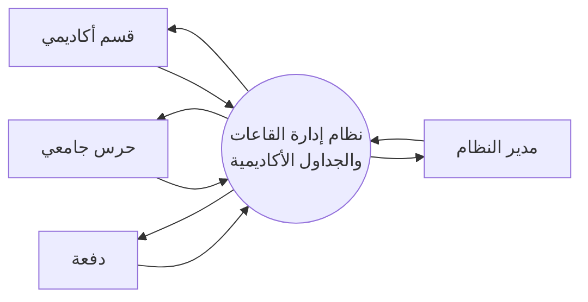
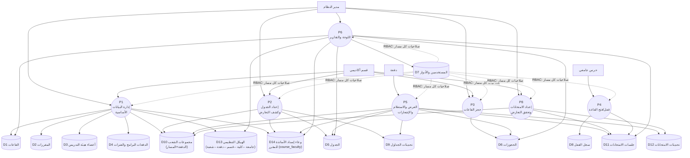
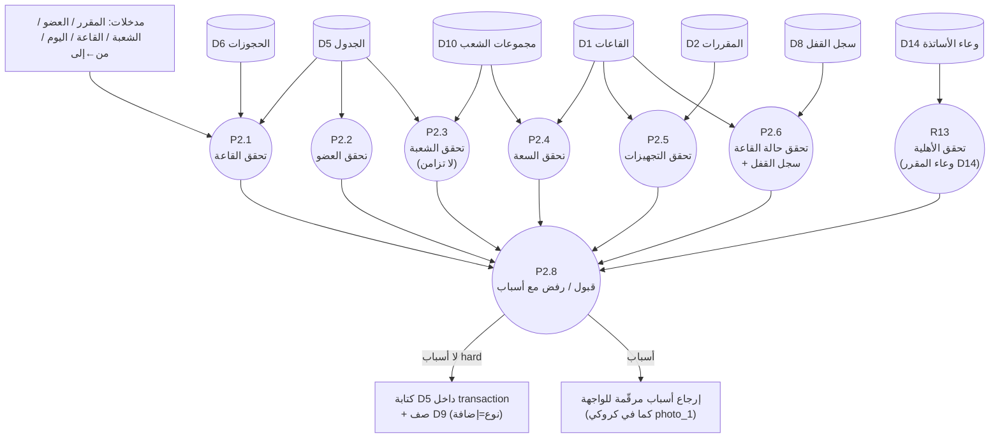
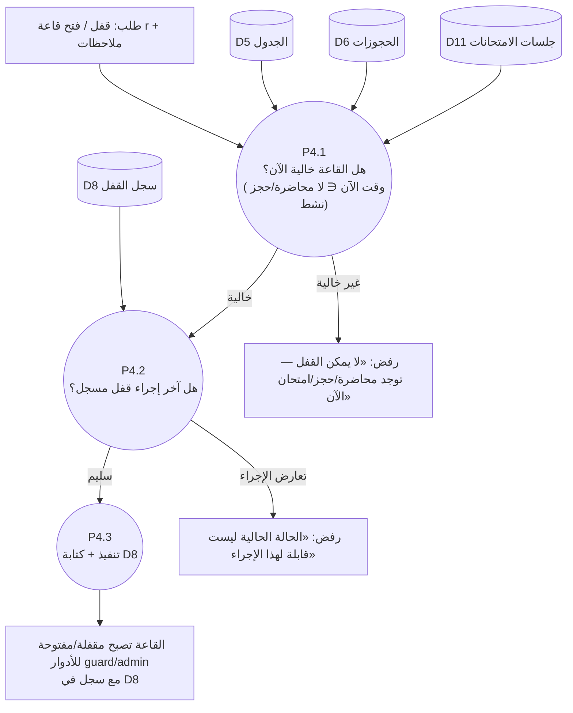
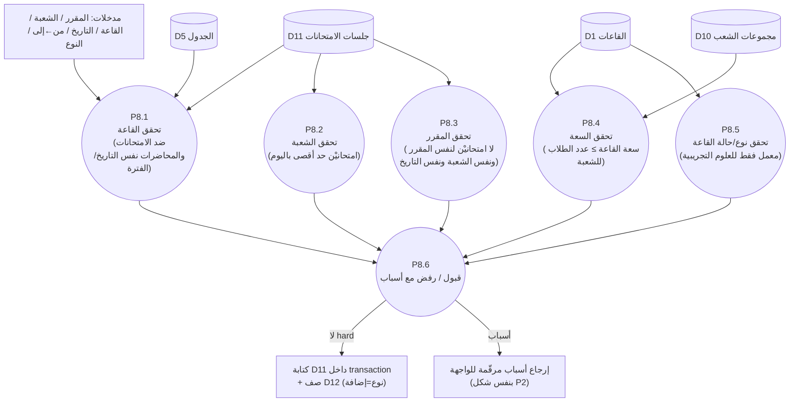

# 04 — مخططات تدفق البيانات (DFD) — تسليم

> نفس مسارات التحليل في الفصل الثالث (مدخل ← معالجة ← مخزن ← مخرج) بصياغة معتمدة للتسليم. البيانات تخدم الشاشات الـ8 + شاشتَي الامتحانات (UC-17/UC-18).

## 4.1 المستوي السياقي (Level 0)

تدفقات:
- **مدير النظام ←**: بيانات أساسية + بيانات حسابات. **→** الجداول، التقارير، سجل القفل.
- **قسم أكاديمي ←**: المقررات/الأعضاء + الجداول والحجوزات. **→** الجداول المعتمدة، حالتها.
- **حرس جامعي ←**: طلب قفل/فتح قاعة خالية الآن. **→** سجل القفل (قوائم القاعات الخالية الآن).
- **دفعة ←**: طلب جدولها/تحديثاته. **→** شاشة عرض جدولها فقط (لا تحرير).

## 4.2 المستوي الأول (Level 1) — العمليات والمخازن

### جدول الربط العملية ↔ المخازن ↔ الشاشة

| العملية | تقرأ | تكتب | الشاشة (الكروكي) |
|---|---|---|---|
| P1 إدارة البيانات الأساسية | D1–D4, D10, D13, D14, D7 | D1–D4, D10, D13, **D14 (وعاء الأساتذة)** | `photo_2` إدارة البيانات الأساسية + إعداد البرامج/الكليات/الشعب + شاشة «الأساتذة المكلفون» على المقرر |
| P2 إعداد الجدول | D1–D6, D10, D13, **D14 (شرط الأهلية R13)** | D5 (+D9) | `photo_1` إعداد الجدول + `photo_7` عرض الجداول |
| P3 حجز القاعات | D1, D5, D6, D8, D11 | D6 | `photo_3` حجز قاعة + `photo_4` القاعات المتاحة |
| P4 قفل/فتح القاعة (guard مركزي) | D5, D6, D8, D11 | D8 | — (شاشة الحارس) |
| P5 العرض والاستعلام | D5, D6, D9, D10, D11, D12, D13 | — | `photo_7` + جداول الامتحانات + قسم التحديثات |
| P6 اللوحة والتقارير | D1, D5, D6, D11, D13 | — | `photo_6` لوحة التحكم (admin: فلتر كلية / dept: كليته فقط) + `photo_5` التقارير |
| P8 إعداد الامتحانات | D2, D10, D1, D5, D13 | D11 (+D12) | شاشة إعداد الامتحان + عرض جدول الامتحانات |
| — تسجيل الدخول (P7) | D7 | D7.last_login_at | `photo_8` |

> ملاحظة المسارات العابرة: P2 وP8 يشتركان تقريبًا في نفس سلسلة التحقق (P2.1..P2.7) — نفس الخدمة Go بمعامل `type=lecture|exam`؛ P4 عند القفل يراعي الامتحانات أيضًا (قاعة فيها امتحان الآن = غير قابلة للقفل).

## 4.3 المستوى الثاني — P2 «إعداد الجدول وكشف التعارض»

**عقد الاستعلام**: تسلسل التحقق = القاعة ← العضو ← الشعبة ← السعة ← التجهيزات ← الحالة ← القفل ← **R13 الأهلية**. كل سبب يخرج بصيغة `{ code, message_ar, severity: hard|soft }`؛ `severity=hard` يمنع الحفظ؛ `soft` فقط يلوّن الصف بملاحظة (لا يمنع في v1). الرفض الكلي يرجع أول 3 أسباب hard؛ «عضو هيئة التدريس: لا تعارض ✓» يظهر عند سلامة هذه السلسلة.

**القرار التزامني (معتمد)**: التحقق والتحويل لـ transaction واحدة: `SELECT … FOR UPDATE` على صف القاعة المعنية من D1 → إعادة تنفيذ P2.1 P2.2 P2.3 + شرط R13 داخل نفس الـ transaction → إدراج في D5 → إدراج D9 → COMMIT. أي تداخل زمني محاسبي بين محاولتين متزامنتين يُفشل الثانية (HTTP 409 «القاعة محجوزة للتو»).

## 4.4 المستوى الثاني — P4 «قفل/فتح القاعة (حرس جامعي)»

القفل الذكي: **لا** يمنع admin/dept من التحرير (هما حجة أعلى)؛ يمنع فقط عمليات الحارس غير الزمنية ومسارات «القاعات المتاحة/الحجز» من اعتبار القاعة متاحة وقت القفل (يعاملها P2/P3 كحالة غير «متاحة»).

## 4.5 المستوى الثاني — P8 «إعداد الامتحانات وكشف التعارض»

عقد التحقق مشترك مع P2 (نفس `{ code, message_ar, severity }`)؛ خدمة Go نفسها تُستدعى بمعامل `type=exam` وتضيف قاعدة «امتحانيْن للشعبة/يوم — R8» وقاعدة التقاطع «محاضرة ↔ امتحان في نفس القاعة/الفترة — R7».

## 4.6 مصادر البيانات والأدوار (تحقق من الاتساق)

| المخزن | من يقرأ/يكتب | ملاحظة 30 ثانية |
|---|---|---|
| D7 المستخدمين | الكل (RBAC) | كلمة مرور Hash؛ `batch` يرى جدول دفعته فقط؛ `last_login_at` للإشعارات |
| D8 سجل القفل | guard (كتابة)، admin (قراءة) | لا DELETE؛ يُلغى بـ action عكسي موثق |
| D9 تحديثات الجداول | P2/P7 (كتابة)، batch (قراءة) | «جديد» = `created_at > users.last_login_at` |
| D10 مجموعات الشعب | P2/P8 (قراءة)، admin (كتابة) | unique(batch_id, track) |
| D11 جلسات الامتحانات | P8 (كتابة)، ↔ تحقق متقاطع مع D5 (قراءة) | بنفس قواعد P2 + حد امتحانيْن للشعبة/اليوم |
| D12 تحديثات الامتحانات | P8/P7 (كتابة)، batch (قراءة) | مرآة D9 |
| D13 الهيكل التنظيمي | admin (كتابة)، الكل (قراءة) | يفرض faculty-scoping على dept في الاستعلامات |
| D14 وعاء إسناد الأساتذة | P1 (كتابة)، P2 (قراءة) | N : M بين courses وfaculty؛ `UNIQUE(course_id, faculty_id)`؛ يغذّي شرط الأهلية R13 |

## 4.7 ملاحظة النطاق

- **الامتحانات داخل النطاق منذ الاعتماد** (P8) — لا مخطط «توليد جدول تلقائي» في v1؛ عند تفعيله لاحقًا يُضاف **P9 «محرك الاقتراح CP-SAT (Google OR-Tools)»** خلف زر صريح يعيد استخدام P2 للتحقق من كل مسودة قبل اعتمادها — الخوارزمية المعتمدة، لا بدائل لها في الإنتاج.
- الكيان الجدولي هو **الشعبة (GROUPS)** وليس الدفعة: كل تدفق «دفعة» في المخططات أعلاه أصبح عمله على (الدفعة ← مساريها: دبلوم + بكلاريوس).
